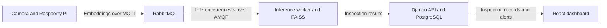

# Smart Tomato Disease Monitoring

An Edge AI and IoT prototype built for my final-year Master's project in collaboration with AZURA / MARAISSA. It supports visual inspection of tomato plants in greenhouses, from image capture to human review.

A Raspberry Pi 4 captures images and extracts 1,280-dimensional embeddings using MobileNetV2 and TensorFlow Lite. It sends the embeddings over MQTT for server-side analysis. The original image can be requested when an inspection needs visual confirmation. The web dashboard lets operators inspect results, review uncertain predictions, and record corrections.

<!-- When the images are available, add a real dashboard screenshot here and a Raspberry Pi prototype photo under "Edge device". -->

[Architecture](#system-architecture) · [Local setup](#local-setup) · [Message format](#edge-message-format) · [Evaluation](#ai-evaluation-results) · [Tests](#tests)

## System Architecture



The edge device extracts and normalizes image embeddings. The inference worker identifies whether each embedding represents a leaf or fruit and searches the corresponding FAISS index. Low routing confidence or disagreement among retrieved neighbors can flag an inspection for review.

Django stores inspections, device records, alerts, and review decisions in PostgreSQL. Django Channels and Redis support real-time notifications. Operators can confirm or correct an inspection while preserving the original prediction.

When visual confirmation is needed and evidence requests are enabled, the backend sends a command to the relevant edge device. The evidence agent uploads the corresponding image and the backend associates it with the inspection.

## Edge Device

The prototype uses a Raspberry Pi 4 and a camera. MobileNetV2 runs on the device through TensorFlow Lite. Organ classification and FAISS search run on the server.

| Component | Source |
| --- | --- |
| Image capture, feature extraction, and MQTT publishing | [`pi_extract_and_publish.py`](ai_assets/edge_runtime/scripts/pi_extract_and_publish.py) |
| Handling image evidence requests | [`pi_evidence_image_agent.py`](ai_assets/edge_runtime/scripts/pi_evidence_image_agent.py) |
| Edge runtime dependencies | [`requirements-edge.txt`](ai_assets/edge_runtime/requirements-edge.txt) |
| TensorFlow Lite feature extractor | [`mobilenetv2_feature_extractor.tflite`](ai_assets/models/mobilenetv2_feature_extractor.tflite) |

## Local Setup

### Requirements

- Git
- Docker with Docker Compose
- A Raspberry Pi and camera for physical image capture. The central web platform can be started separately.

### Start the central platform

```bash
git clone https://github.com/medbaihich/projet-tomate-monitoring.git
cd projet-tomate-monitoring
cp .env.example .env
```

Open `.env` and replace each `change-me` value with an appropriate local password, secret, or token. For a demo confined to this computer, set `MQTT_BIND_ADDRESS=127.0.0.1`. To connect a Raspberry Pi on the local network, configure the broker binding so the device can reach it.

```bash
docker compose up --build -d
docker compose ps
```

Once the backend has finished applying its migrations, create a local administrator:

```bash
docker compose exec backend python manage.py createsuperuser
```

Open [http://localhost](http://localhost) and sign in. Traefik routes requests to the web frontend or backend. If a service fails to start, inspect the backend and worker logs:

```bash
docker compose logs --tail=100 backend ai_worker
```

### Verify an inspection

1. Register an edge device in the platform.
2. Configure the edge publisher to use that device identifier and connect to the broker.
3. Capture an image and publish its embedding.
4. Open the inspections page and confirm that a record appears for the device.
5. For a result flagged for review, verify that the inspection can be reviewed in the dashboard. To exercise image retrieval, enable evidence requests and run the edge evidence agent.

## Edge Message Format

The worker consumes feature-vector messages routed through RabbitMQ. See the [payload validator](ai_assets/ai_worker/payload_validator.py) for the complete validation rules.

| Field | Expected value |
| --- | --- |
| `schema_version` | `raspberry-edge-payload.v1` |
| `message_type` | `feature_vector` |
| `source_message_id` | Non-empty message identifier |
| `device_identifier` | Non-empty edge device identifier |
| `captured_at` | ISO 8601 timestamp with timezone information |
| `feature_model` | Non-empty model identifier |
| `feature_dim` | `1280` |
| `l2_normalized` | `true` |
| `feature_vector` | Array of 1,280 finite numeric values |

Optional fields include `image_id`, `vector_norm`, `capture_artifact`, and `edge_metadata`. The worker computes the vector norm and rejects messages whose norm falls outside the inclusive range of `0.98` to `1.02`.

Inference requests are routed to `tomato.ai.inference.requests.v1`. The worker configuration also defines a dead-letter queue for rejected messages.

## AI Evaluation Results

The evaluation covered **6,383 images across 15 classes**. Organ-routing accuracy measures how often the photographed organ is identified correctly as a leaf or fruit. Global label accuracy measures how often the predicted class matches the reference label.

| Metric | Result |
| --- | ---: |
| Organ-routing accuracy | 98.70% |
| Global label accuracy | 90.46% |
| Fruit label accuracy | 87.43% |
| Leaf label accuracy | 95.80% |
| Agreement between the nearest match and the majority vote | 93.56% |

Performance varied across classes. For example, reported accuracy was **46.90%** for Catfaced and **61.35%** for Fruit Cracking.

The repository includes scripts for [evaluating single-instance images](ai_assets/scripts/evaluate_single_instance_dataset.py), [generating evaluation reports](ai_assets/scripts/generate_evaluation_report.py), and [analyzing errors](ai_assets/scripts/analyze_evaluation_errors.py).

<!-- To document how to reproduce the table, add the exact evaluation command, the resulting report, and the method used to separate evaluation images from FAISS reference images. -->

## Tests

The [CI workflow](.github/workflows/ci.yml) runs Django tests and checks that the frontend passes linting and builds. The Django suite covers accounts, devices, inspections, result ingestion, monitoring, notifications, and review, among other modules.

With the local Compose stack running, use the following command to run the backend suite:

```bash
docker compose exec backend python manage.py test
```

Run backend tests against a development database. For local frontend checks, run:

```bash
cd frontend
npm ci
npm test
npm run lint
npm run build
```

The component checks cover the application code. Use the inspection workflow above to verify the physical camera and the full message path.

## Repository Guide

| Path | Purpose |
| --- | --- |
| [`ai_assets/edge_runtime/`](ai_assets/edge_runtime/) | Image capture, embedding extraction, MQTT publishing, and evidence upload |
| [`ai_assets/ai_worker/`](ai_assets/ai_worker/) | Message validation, inference request handling, and result delivery |
| [`ai_assets/ai_engine/`](ai_assets/ai_engine/) | Vector inference and similarity search |
| [`ai_assets/scripts/`](ai_assets/scripts/) | Data preparation, model export, index generation, and evaluation |
| [`backend/`](backend/) | Django API, persistence, inspections, reviews, and alerts |
| [`frontend/`](frontend/) | React dashboard and operator workflows |
| [`docker-compose.yaml`](docker-compose.yaml) | Local orchestration of the central services |

## Prototype Limitations

- Image quality depends on lighting, capture angle, blur, and occlusion.
- Class performance varies with reference sample coverage and the visual similarity of symptoms.
- The current prototype relies on Wi-Fi connectivity.
- The evaluation figures describe the image set used for the reported run. Field performance requires validation under representative greenhouse conditions.

## Author

**Mohamed BAIHICH**
